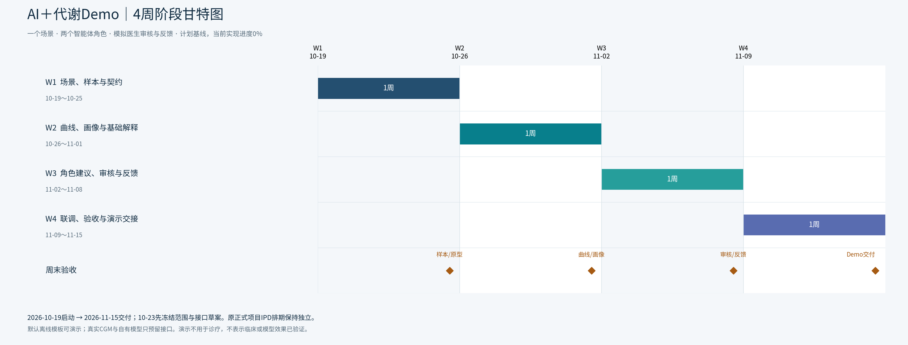

# AI＋代谢管理 Demo交付方案

默认排期：**2026-10-19～2026-11-15，4周**。配置：3–4人，产品、前端、后端/数据、AI；临床顾问提供演示内容支持。人员尚未具名。

## 文件

| 文件 | 内容 |
| --- | --- |
| [时间线与分工Excel](AI-metabolic-demo-plan.xlsx) | 任务时间线、角色分工、四周计划、里程碑、使用说明，共5个工作表 |
| [Demo架构Markdown](demo-architecture.md) | 范围、架构图、页面、数据/API契约、AI模式、分工、16项任务与验收 |
| [甘特图PDF](AI-metabolic-demo-gantt.pdf) | 4周阶段总览＋16项任务明细，共2页 |
| [总览PNG](AI-metabolic-demo-gantt-overview.png) | 适合内部汇报 |
| [任务PNG](AI-metabolic-demo-gantt-tasks.png) | 显示岗位任务及并行安排 |
| [总览SVG](AI-metabolic-demo-gantt-overview.svg)、[任务SVG](AI-metabolic-demo-gantt-tasks.svg) | 可放大的矢量图 |
| [完整ZIP包](AI-metabolic-demo-package.zip) | 上述文件、任务CSV、生成脚本与验证记录 |
| [任务CSV](demo-tasks.csv) | 独立Demo任务基线，权重合计100% |

## 演示闭环

内置模拟或授权去标识数据 → 血糖曲线 → 统计画像与解释 → 饮食/活动候选 → 模拟医生审核 → 用户反馈。

首期建议React＋FastAPI＋SQLite，用一个网页切换患者和模拟医生视图。默认模板模式无密钥可运行，LLM联调可选；真实CGM、穿戴设备、自有模型和正式身份权限只预留接口。

这些文件是Demo设计与计划，尚未实现或部署软件。页面需明确标记演示属性；不用于真实诊疗，不宣称已验证模型或疗效。原正式项目的IPD文件、PPT和14周计划保留，本Demo任务集独立管理。

## 维护计划

- Excel任务表E/F列修改日期，时长与周条带重算更新；每周任一天与任务相交即填色。PNG/SVG/PDF按实际日历天定位，起止日均计入。
- I列按验收证据更新成熟度，J列及J23计算实际贡献；当前均为0。Excel首次打开需自动重算。
- FS为前项完成后开始；SS允许按冻结接口/样本并行。条带重叠不代表已完成资源约束排程。
- 超过4周时需扩展周列或重新基线化。
- 编辑Excel不会更新静态图片；维护CSV后运行`python build_demo_plan.py`可重建文件，但会覆盖手工Excel改动。
- 生成脚本依赖Python、matplotlib、openpyxl及`FONTFILE`指定的中文字体；换机器时调整字体路径。

## 验证

已核对16项任务、权重合计100%、全部日期与FS/SS计划依赖、Excel5个工作表，以及两页PDF和任务编号。日期/成熟度更新的电子表格功能验证使用隔离副本，不改变交付基线。具体记录见[verification.txt](verification.txt)。
