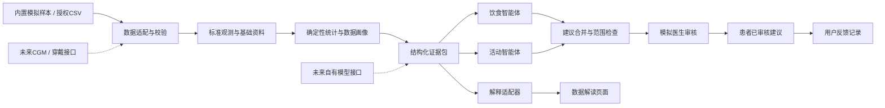

# AI＋代谢管理 Demo：架构、分工与4周计划

版本：v0.1；编制日期：2026-10-13，北京时间。

本方案是从原完整项目方案中缩减的演示版本，保留原正式项目文件与排期。默认沿用2026-10-19启动，2026-11-15完成Demo交付；这是待团队落实后的计划基线，当前软件实现完成度为0%。

## 1. Demo要证明什么

让内部团队或合作方在约5–8分钟内看懂：连续血糖数据如何进入平台，如何形成有依据的解释，如何由两个专业智能体提出候选建议，经过模拟医生审核后交给用户，并收集反馈。

一条固定主线：**导入数据 → 血糖曲线 → 基础画像与解读 → 饮食/活动候选建议 → 模拟医生审核 → 用户反馈**。

Demo仅展示产品闭环、数据可追溯性和交互价值；不证明模型效果、医疗安全或干预疗效，也不代表正式上线。

## 2. 范围控制

| 本期必须完成 | 本期预留接口 | 后续项目验证 |
| --- | --- | --- |
| 一个合适成年人演示场景 | 真实CGM厂商适配器 | 厂商接入、实时同步与真实用户试点 |
| 一种CSV导入格式与内置模拟数据 | 穿戴设备数据接口 | 活动、睡眠等多源数据 |
| 性别、年龄、身高、体重及预设风险背景 | 自有模型推理接口 | 数据授权、标签、训练与独立评估 |
| 曲线、基础统计、信息缺失提示 | 正式账号与机构权限接口 | 隐私合规、身份验证和多机构隔离 |
| 饮食与活动两个智能体角色 | 模型/规则版本字段 | 经验证的个性化干预 |
| 一个统一建议列表与审核/反馈状态 | 异常事件接口 | 高风险事件处置与临床值守 |

不加入真实蓝牙连接、复杂账号系统、支付、完整运营后台、多疾病管理、药物调整或自动诊断。作息智能体和完整训练流程不在本次四周范围内。

内置数据必须标记“模拟数据”。使用外部数据仅接受有相应用途授权的去标识样本，禁止为演示默认接收真实身份或原始医疗记录。

## 3. 演示场景与页面

演示人物采用虚构ID，不使用真实姓名。固定基础资料与风险背景用于展示流程，界面持续显示“演示数据，不用于诊疗”。支持选择一个预设日期窗口，不要求用户上传数据才能进入演示。

### 患者视图

1. 数据导入/示例数据：选择内置样本，或导入规范CSV；显示校验结果。
2. 血糖看板：时间曲线、数据更新时间、单位、缺失与覆盖提示。
3. 数据画像与解读：基本资料、近期平均与波动、可计算事实、可能解释和信息缺口。
4. 建议与反馈：展示已审核建议，用户选择“计划执行/已执行/暂不执行”，填写简单反馈。

### 模拟医生视图

查看同一演示人物、候选建议、依据与限制，完成“批准/编辑/拒绝”。草稿、被拒绝与过期建议不进入患者列表；编辑后仍执行范围与禁忌检查。异常页面只展示数据缺失、文件错误、AI不可用等软件状态，不模拟真实急救保障。

同一网页切换患者与模拟医生视图，便于演示。这个切换只是Demo操作，不代表已经实现医疗身份验证或正式授权。

## 4. 软件架构

建议使用一个Web前端与模块化Python后端：React＋FastAPI＋SQLite。数据库由数据访问层封装，后续可迁移PostgreSQL。AI适配器、统计、审核和数据适配器在同一后端内划分模块，首期无需拆成多套服务。

前端依据团队熟悉程度可换框架；核心是冻结接口，保证后端、前端和AI能并行开发。部署选择本地或机构允许的私有演示环境，保留一键使用示例数据和离线降级路径。

### 模块边界

| 模块 | 责任 | 首期输入/输出 |
| --- | --- | --- |
| 数据适配器 | 导入、字段校验、去重、时间与单位处理 | CSV/内置样本 → 标准观测与质量标记 |
| 统计与画像 | 计算事实、汇总资料与信息缺口 | 标准观测 → 版本化统计与画像 |
| AI适配器 | 解释和两个角色的候选建议 | 证据包 → 受控结构化内容 |
| 建议服务 | 合并、范围检查、状态与证据 | 候选 → 待审核建议 |
| 审核服务 | 模拟批准、编辑、拒绝 | 审核动作 → 投递状态与记录 |
| 反馈服务 | 记录执行意愿、执行情况和备注 | 用户动作 → 反馈记录 |
| 前端 | 演示人物与双视图交互 | 曲线、解读、审核与反馈 |

## 5. 最小数据与接口契约

### CSV与标准观测

CSV必需列：`timestamp`、`glucose_value`、`unit`。一个文件对应一个虚构或去标识人物；导入时声明来源和时区，不从文件名推断身份。

标准观测保留：`observation_id`、`subject_id`、`source_id`、`metric_code`、`observed_at`、`received_at`、`value`、`unit`、`quality_flags`、`schema_version`。时间内部统一UTC，展示按选定时区；单位明确转换并保留原始数值。错误值、重复与缺失必须有可见状态，不无提示插值。

基础资料：年龄、性别、身高、体重及更新日期。预设风险背景包括是否确诊、相关用药、低血糖史和运动限制，用于展示限制模式；缺失时不给强个性化行动建议。

### 核心实体

`DemoSubject`、`Dataset`、`Observation`、`ProfileSnapshot`、`EvidenceBundle`、`Recommendation`、`ReviewRecord`、`Feedback`。

候选建议携带：角色、动作类别、用户可读内容、证据引用、限制与禁忌、生成模式、版本和有效期。状态主线：`draft → pending_review → approved/rejected → delivered → acknowledged/expired`。

### API示例

| API | 用途 |
| --- | --- |
| `POST /api/demo/datasets/import` | 导入CSV并返回校验结果 |
| `POST /api/demo/datasets/sample` | 加载内置示例 |
| `GET /api/demo/subjects/{id}/observations` | 获取曲线与质量标记 |
| `GET /api/demo/subjects/{id}/profile` | 获取资料与数据画像 |
| `POST /api/demo/subjects/{id}/reports` | 生成选定窗口的统计、解释与候选建议 |
| `GET /api/demo/recommendations` | 按审核状态获取建议 |
| `POST /api/demo/recommendations/{id}/review` | 模拟批准、编辑或拒绝 |
| `POST /api/demo/recommendations/{id}/feedback` | 记录用户反馈 |

API返回数据时间、来源、质量、生成模式和版本。模拟审核接口不得直接作为真实患者服务暴露；正式账号权限属于后续生产化任务。

## 6. AI怎样做得简单且诚实

统计与画像采用项目自建的确定性计算；基础画像仅表达血糖数据与已知背景，不推断未测量的疾病分型、器官损害或胰岛素抵抗程度。

解释与角色建议采用统一接口，支持两种明确显示的模式：

- **模板演示模式，默认可离线运行**：用预设且审核过的解释模板/候选动作展示完整流程，不依赖API密钥，也不宣称自有模型已经训练。
- **LLM联调模式，可选**：在允许的环境中调用模型，仅使用结构化统计和适用条件；不让模型重新计算数字。密钥在环境配置中管理，不放入代码、数据或交付文档。服务超时或输出不合格时返回有提示的模板降级。

饮食、活动智能体可作为两个受控角色函数实现，共用一套模型适配器；首期不搭建自由自治的智能体网络。统一输出schema、去重/冲突处理与范围规则后，建议进入模拟审核。

未来自有模型以`DecisionModel.predict(evidence)`形式接入；现在只定义接口和输出契约。Demo不开展训练或模型效果宣传，也不以“AI模型未到位”为由阻塞产品闭环演示。

## 7. 建议分工：3–4人，姓名待认领

| 角色 | 交付职责 | 可兼任方式 |
| --- | --- | --- |
| 项目/产品负责人 | 场景与范围、演示原型协调、风险边界、测试脚本、验收与演示讲解 | 可兼任设计与轻量测试组织 |
| 前端 | 看板、画像、建议、模拟审核、反馈及错误状态 | 一个Web应用覆盖两个视图 |
| 后端/数据 | CSV/样本、标准观测、统计、存储、接口、审核状态、集成与演示部署 | 合并数据工程和基础设施职责 |
| AI | 解释适配器、两角色候选、合并范围检查、降级、自有模型接口 | 若只有3人，可由具备能力的后端兼任，并减少可选LLM联调 |

临床顾问用于审核演示内容、适用条件和禁忌边界；该工作不等于真实医疗服务批准。若无人可审核，使用一般教育内容与模板，避免未经复核的个性化健康行动。

## 8. 四周计划与里程碑

| 周次 | 日期 | 重点 | 周末验收 |
| --- | --- | --- | --- |
| W1 | 2026-10-19～10-25 | 一个场景、样本、字段接口、页面原型 | 10-23冻结Demo范围与接口草案；10-25完成样本与原型走查 |
| W2 | 10-26～11-01 | 导入、曲线、统计、画像、基础解释 | 11-01能从样本看到曲线和有依据的画像 |
| W3 | 11-02～11-08 | 饮食/活动候选、建议状态、模拟医生审核、用户反馈 | 11-08完成受控的建议审核与反馈流程，集成整改继续推进 |
| W4 | 11-09～11-15 | 端到端联调、异常与降级、部署、演示脚本 | 11-15交付稳定Demo与演示说明 |

这不是正式产品IPD准入计划；首期Demo使用轻量里程碑。后续真实试点重新进入原IPD流程和适用机构/合规路径。

## 9. 16项任务与交付证据

| ID | 任务 | 主责 | 日期 | 验收 |
| --- | --- | --- | --- | --- |
| D01 | 场景、范围与演示主线 | 产品 | 10-19～10-20 | 一个场景、六步主线、范围清单 |
| D02 | 内置样本与CSV规范 | 后端/数据 | 10-19～10-21 | 样本可读、来源/单位/时区明确 |
| D03 | 架构、字段与API契约 | 后端/数据 | 10-21～10-23 | 前后端/AI接口可并行开发 |
| D04 | 患者与模拟医生原型 | 前端 | 10-21～10-23 | 两视图主路径可走查 |
| D05 | 导入、校验与存储 | 后端/数据 | 10-26～10-28 | 内置样本/合法CSV落库，错误可见 |
| D06 | 曲线与数据质量展示 | 前端 | 10-26～10-29 | 时间、单位、缺失提示正确 |
| D07 | 统计与画像服务 | 后端/数据 | 10-26～10-29 | 可重复统计、有证据与信息缺口 |
| D08 | 画像与解读页面 | 前端 | 10-28～10-30 | 事实、解释与限制分别呈现 |
| D09 | 解释适配器与降级 | AI | 10-26～10-30 | 模板可运行，LLM可选且模式明示 |
| D10 | 饮食/活动角色与建议合并 | AI | 11-02～11-04 | 两角色输出受控候选，无冲突投递 |
| D11 | 建议审核状态与API | 后端/数据 | 11-02～11-04 | 草稿/拒绝/过期不进入患者列表 |
| D12 | 模拟审核与反馈页面 | 前端 | 11-02～11-05 | 批准/编辑/拒绝与执行反馈可回放 |
| D13 | 内容与范围复核 | 产品＋临床顾问 | 11-02～11-05 | 仅展示适用演示内容，限制可见 |
| D14 | 端到端集成与问题修复 | 后端/数据 | 11-06～11-10 | 样本到审核反馈完整走通 |
| D15 | 演示验收与异常测试 | 产品 | 11-09～11-12 | 主路径、错误导入、缺失与AI降级通过 |
| D16 | 演示部署、脚本与交接 | 后端/数据 | 11-13～11-15 | 可启动、可重置、演示脚本可复用 |

任务编号属于Demo独立任务集，不与正式项目WBS合并计算。完整协作角色、依赖和任务成熟度见同目录的CSV与Excel。

## 10. 验收与演示脚本

Demo验收要求：不必提供密钥就能加载样本；数据曲线与统计一致；每个解释或建议能查看依据/模式/限制；模拟审核状态生效；用户反馈可回看；错误导入、缺失和AI不可用时有清楚提示；重置后能重复演示。

推荐现场顺序：加载样本，查看曲线与数据质量，打开画像解读，生成两个角色候选，切换模拟医生批准/拒绝，回到患者查看已审核建议，填写反馈，最后演示一次AI不可用时的模板降级。

所有演示页面持续标识Demo属性。交付包括运行说明、示例数据、接口契约、演示脚本、已知限制与后续接入清单。当前文件只完成设计和计划，没有已经运行的Demo可宣称。

## 11. 计划维护

Excel包含周计划、16项任务时间线、角色分工、里程碑和使用说明。周条带按任务日期自动重算，实际完成度按证据成熟度与权重计算；默认均为0。甘特图另提供PNG、SVG和PDF，日期精确到日。

任务条带的重叠表示并行设计、开发或联调，不代表任何人已经具备无限容量。只有3人时，后端兼任AI需优先保留模板模式并检查排期；不能从本图直接宣称已完成资源约束关键路径计算。
