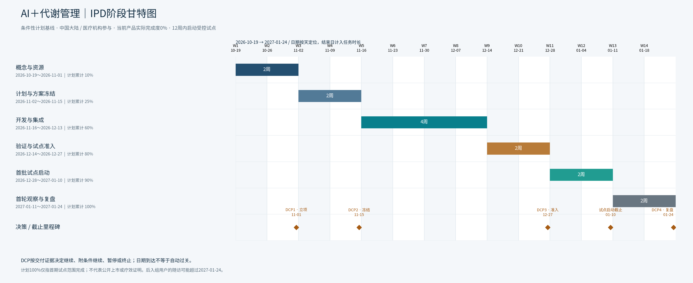

# AI＋代谢管理：项目甘特图

日期基线：2026-10-19～2027-01-24，北京时间。依据已确认的[软件设计与IPD规划v0.2](../project-design.md)及[20项WBS](../ipd-deliverables.csv)制作，任务起止日期保持不变。

## 文件

- [可编辑Excel甘特图](AI-metabolic-IPD-gantt.xlsx)：阶段、20项任务、里程碑、使用说明，共4个工作表。
- [两页PDF](AI-metabolic-IPD-gantt.pdf)：阶段总览＋任务明细，适合查阅、打印。
- [阶段总览PNG](AI-metabolic-IPD-gantt-overview.png)
- [20项任务PNG](AI-metabolic-IPD-gantt-tasks.png)
- [阶段总览SVG](AI-metabolic-IPD-gantt-overview.svg)、[任务SVG](AI-metabolic-IPD-gantt-tasks.svg)：矢量图，可按需修改或放大。
- [完整交付包](AI-metabolic-IPD-gantt-package.zip)
- [生成脚本](build_gantt.py)、[验证记录](verification.txt)



## 里程碑

| 项目 | 日期 | 通过条件 |
| --- | --- | --- |
| DCP1：立项 | 2026-11-01 | 负责人、资源、首期范围和合法接入路径落实 |
| DCP2：方案冻结 | 2026-11-15 | PRD、接入PoC、数据用途、验收口径确认 |
| DCP3：试点准入 | 2026-12-27 | 关键缺陷关闭、适用批准、临床与运营容量到位 |
| 首批试点启动截止 | 2027-01-10 | 获准首批入组并运行建议与反馈闭环 |
| DCP4：首轮复盘 | 2027-01-24 | 根据首批观察与运行报告决定扩大、延长、调整或停止 |

技术评审TR2/3随开发设计与集成执行，现有方案没有冻结到某一天，本图不额外虚构其精确日期。

## Excel使用

1. 在“阶段甘特图”或“任务甘特图”修改E/F列的计划开始、完成日期。时长和周条带公式随重算更新。
2. 每个周格只要与任务任一天有交集就填色，因此是按周示意；PNG、SVG、PDF的条带按实际日历天绘制，起止日均计入时长。
3. “任务甘特图”I列是证据成熟度：0、0.25、0.5、0.75、1。只有对应验收证据成立才更新。J列与J27计算权重乘成熟度和总实际完成度。
4. 当前实际成熟度与贡献均为0。阶段总览的10%、25%、60%、80%、90%、100%是拟议计划目标，不能作为实际进展填入。
5. 公式未写预计算缓存，首次用Excel打开时自动重算；如果条带未显示，请将计算选项设为自动。已用独立副本的实际电子表格引擎验证日期调整与进度公式。
6. 当前时间轴为14周。任务日期超出该范围时，应扩展周列或重新基线化，不能只修改日期而忽略显示范围。

Excel编辑不会自动改变静态图片和PDF。如需统一更新基线，先维护CSV日期，再运行生成脚本。脚本会重新生成文件，覆盖手工修改的Excel，运行前保留需要的改动。

## 状态与边界

这是条件性计划，不代表实际产品、模型或临床工作已完成。训练数据许可/标签、CGM接口、具名团队、医生复核容量及机构与适用准入均是前置条件；未验证模型保持离线或影子模式。首轮试点范围完成不等于公众上市或疗效证明。后入组用户的随访可能超过2027-01-24。

当前没有经确认的完整依赖网络与资源容量，未计算关键路径。图中虚线表示评审或截止日期，不表示已计算的关键路径。

## 验证与复用

核对了20项任务与原WBS日期、权重合计100%、14周时间轴、两页PDF及所有任务编号。功能验证在副本中把D01改为2026-11-23～12-06，周条带正确移到W6/W7；成熟度设为0.25后，贡献及总实际完成度变为1.25%，没有公式错误。副本测试不改变交付基线。

运行依赖：Python、matplotlib、openpyxl，以及脚本`FONTFILE`指定的已安装中文字体。完整包保留`gantt/`子目录和父级WBS源文件，便于运行：

```bash
python gantt/build_gantt.py
```

如果在其他系统运行，请将`FONTFILE`改为该机器上可用中文字体的路径。
