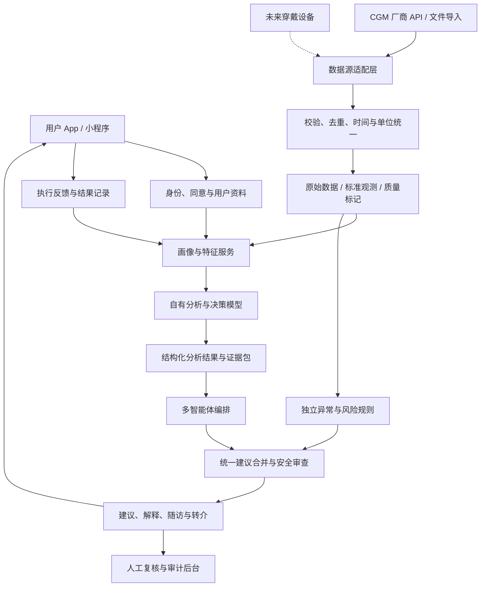

# AI＋代谢全病程管理：软件设计与 IPD 规划 v0.2

编制日期：2026-10-13（北京时间）。本文是立项与架构评审草案，不代表已经开发完成、通过临床验证或获准提供诊疗服务。

## 1. 规划基线与待确认事项

用户已确认：中国大陆、医疗机构参与；项目目前从零起步，但近期会有可用于训练的数据；目标约三个月内启动试点。

规划基线：2026-10-19 启动，2026-12-28 起分批入组，2027-01-10 前完成首批试点启动，约四周试点观察到 2027-01-24。三个月目标是启动可控试点，不是证明疗效或完成公开商业发布。

排期成立的前提：前两周落实具名临床负责人、可投入的技术团队、试点机构及 CGM 接入路径；前四周取得可验证的数据样本及相应用途授权。建议约 7–9 名全职技术/产品人员，另有稳定参与的临床与合规负责人。尚未获得这些资源，排期须标记为“条件性基线”。

待确认：团队和预算；合作医院/科室/负责人；CGM 厂商、实时/历史接口及授权；训练数据交付日期、规模、标签、来源和用途许可；试点是临床研究还是服务验证；预计入组人群。医疗机构参与并不自动确定产品监管属性：预期用途、功能、宣传及试点性质需要临床/法规负责人判定。伦理、机构准入、注册等若适用，是入组前置条件，不以软件测试或医生复核替代。

项目长期目标是覆盖代谢风险发现、持续监测、行为干预、随访与转介。首期仅实现“CGM 数据→可解释画像→行为建议→反馈”的闭环，不宣称仅凭血糖数据即可实现全面代谢评估或诊断。

## 2. 用户范围与产品分层

“所有血糖已经存在或可能存在问题的人”是长期服务人群，不宜直接作为同一套算法的首期验证人群。

| 层级 | 用户 | 首期服务与边界 |
|---|---|---|
| A | 未确诊但关注血糖、存在代谢风险的成年人 | 数据解释、生活方式教育、提示必要时到医疗机构评估；不由 CGM 单独诊断糖尿病 |
| B | 已确诊、病情稳定的成年人 | 在明确用药与医生指导背景下提供生活方式管理和随访辅助；首期建议优先选稳定的 2 型糖尿病/高风险人群开展试点 |
| C | 使用胰岛素或其他可能引起低血糖的药物、既往严重低血糖、复杂合并症等 | 进入更严格规则和临床协作路径；运动、禁食等建议不能套用普通用户策略 |
| D | 妊娠、未成年人、急性疾病或其他需专科照护的人群 | 不纳入首期自动个性化干预试点；保留解释与转介路径，后续专门验证 |

不同用户按已知病史、药物、数据质量和风险进入不同服务路径。缺失关键风险信息时，产品仍可展示数据并提供一般教育，但降低个性化建议力度。人群分层由临床负责人确认，产品不得自行推断“低风险”。

长期“全病程”按服务路径而非模型猜测诊断组织：风险关注→医疗评估→确诊后的稳定管理→需要强化随访/治疗协作→复杂病情与专科管理。首次就诊、诊断变化、药物变化、出院等作为路径切换事件；诊断与治疗状态由用户提供并经授权医疗信息/医生确认，不能由 CGM 单独生成。长期病程状态与每日数据波动分别存储，短期异常不自动修改诊断。

### 首期最小范围

必须：注册/授权、基本资料、风险问卷、1 家 CGM 接入、血糖曲线、数据质量提示、分层画像、每日解释、低风险行为建议、异常提示与转介、建议反馈、审计与医生复核后台。试点个性化建议默认由医生审核后发布；医疗机构须有可承担工作量的复核和异常处理安排。

增强：饮食/运动/睡眠的简短事件记录，帮助理解 CGM 波动；这些是用户记录，不等同于已接入穿戴设备。没有事件记录时，只能表达可能原因，不能断言“某餐导致升高”。

首期自有模型训练与软件开发并行：实际数据到位后完成数据审计、任务/标签定义和首轮训练；模型以离线或影子模式运行，只输出给评审人员，不直接改变用户干预。多智能体同样先产生待复核候选建议。只有达到冻结门槛并获得审批的能力，才进入患者可见流程。

后续：更多 CGM 厂商、手表/手环、活动与睡眠、检验指标、医疗随访、多病种路径及验证过的个性化模型。训练数据“马上会有”不等于已具备授权、标签、代表性和验证数据，这些是 W1–4 的实质交付。

首期不提供：药物剂量调整、自动诊断、个体化禁食处方、无人值守高风险干预、仅靠生成式模型承担急救提醒。CGM 数据本身可能存在传输和生理延迟，不能把产品描述为实时急救保障。

## 3. 软件总体架构

初期采用模块化单体后端＋异步任务队列＋独立模型推理服务。各模块有清晰接口与数据所有权，但不在首期拆成大量微服务。优先保障数据正确、安全回放和上线速度；达到规模或隔离要求后再拆分。

候选技术：Python/FastAPI 后端与模型服务；PostgreSQL 存储标准观测、用户与建议；对象存储保留原始载荷、版本化数据集和模型；Redis/任务队列处理同步与报告。CGM 时序表采用分区、合理索引和聚合表；负载验证后再决定是否引入专用时序扩展。若厂商提供合规云端接口，三个月试点优先采用患者小程序＋医生 Web 工作台；若必须手机蓝牙/SDK，W1 即进行平台兼容验证，可能需要原生 App，随后据实调整排期，不能默认小程序可以直连。

核心后台：用户与同意、设备绑定、同步健康、曲线和数据质量、规则/模型版本、建议复核、异常处理、工单、审计、数据删除与导出。运营人员与临床人员权限分离；按机构和医生授权控制患者列表，算法研究环境不能默认访问直接身份信息。

医生工作台必须支持：分配患者、查看证据与缺失背景、批准/编辑/拒绝建议、记录原因、处理异常、查看待办与超时。建议状态为 `draft → safety_checked → pending_review → approved/rejected → delivered → acknowledged → expired`。草稿与过期建议不能投递；医生编辑后的内容仍需硬规则校验；审核不是后台管理员的通用权限。

首期低风险个性化建议全部进入审核队列；统一的审定教育内容可以按规则直接展示。异常事件走独立通道，并依机构服务时段、责任人和 SLA 设计；不承诺不存在的 24 小时医疗值守。

## 4. 数据采集设计：为未来数据源预留接口

### 4.1 适配器契约

每个数据源实现统一接口：`authorize`、`list_devices`、`fetch_observations`、`handle_webhook`、`get_sync_status`、`revoke`。设备能力表声明支持的指标、采样频率、单位、历史回溯、推送/轮询方式、延迟及质量状态。

接口不假设所有厂商支持全部能力：不支持的操作显式返回能力限制。Webhook 验签、防重放；轮询保存游标，失败重试设上限并支持补拉。断连和撤回授权属于业务状态，不能无限重试。

标准观测字段：

| 字段 | 说明 |
|---|---|
| observation_id / subject_id | 观测唯一标识、内部去标识用户标识 |
| source_id / device_id / source_event_id | 来源、设备、厂商事件标识，支持幂等和溯源 |
| metric_code / value / unit | 指标、数值与标准单位，例如 glucose；保留原始值与单位 |
| observed_at / received_at / source_timezone | 实际采样时间、平台收到时间、来源时区；数据库统一存 UTC，展示使用用户时区 |
| quality_flags / device_status | 缺失、预热、异常值、重复、设备状态等 |
| schema_version / consent_id | 契约版本及对应授权 |
| raw_payload_ref / supersedes_id | 原始载荷引用与数据更正关系 |

血糖统一展示单位但保留原值；转换公式、舍入规则和数据来源可追溯。对不同 CGM 的采样间隔使用时间加权口径；缺失段不通过无提示插值制造正常曲线。接入活动量、心率、睡眠等时增加指标及专属扩展结构，不把复杂睡眠阶段硬塞进单个浮点值。跨设备冲突必须保留来源和优先规则。

### 4.2 资料与风险信息

用户已提出的性别、年龄、身高、体重属于基本资料；体重需保留日期和变化历史。用于临床算法的相关性别/妊娠信息应按实际必要性采集，不以展示性别代替。

个性化建议还需要最小风险问卷：是否已确诊及分型、是否用药及相关药物类别、既往低血糖、妊娠、重大合并症、运动限制。允许“不知道/不愿提供”，对应限制模式，并解释为什么需要这些信息。

可选：目标、工作作息、餐食/运动事件、近期检验资料。采集与训练授权分开；核心服务不应默认要求用户同意模型训练。

### 4.3 存储与接口

核心实体：`User`、`Consent`、`ProfileRevision`、`DeviceBinding`、`Observation`、`SyncCursor`、`BehaviorEvent`、`FeatureSnapshot`、`RiskEvent`、`Recommendation`、`Feedback`、`ModelVersion`、`AuditEvent`。

主要 API 示例：

- `POST /v1/consents`：创建授权；撤回走独立操作并停止相应采集/用途。
- `POST /v1/device-bindings`：绑定设备，不向前端返回厂商凭据。
- `POST /v1/ingestion/{source}/webhook`：厂商回调入口；验签后进入队列。
- `GET /v1/observations?metric=glucose&from=...&to=...`：按授权读取分页数据。
- `GET /v1/glucose/summary?window=...`：返回指标、有效时长、缺失与口径版本。
- `GET /v1/profile`、`GET /v1/recommendations`：返回版本化画像与建议。
- `POST /v1/recommendations/{id}/feedback`：记录执行与主观反馈。
- `POST /v1/reviews/{id}/resolution`：授权临床人员记录复核与处置。

接口返回 `data_as_of`、质量状态、来源、版本；错误分为权限、缺失、过期、低质量和不可用。移动端不因模型失败失去基础曲线查看能力。

## 5. 决策模型：把可计算事实与生成解释分开

### 5.1 四层能力

1. 确定性统计：有效佩戴时间、数据覆盖、平均水平、波动、按适用人群定义的区间指标、昼夜/餐后模式。阈值与适用性由临床负责人审核并版本化；短期或不足质量的数据不输出强结论。
2. 健康画像：长期基本特征＋近期模式＋风险背景＋用户目标＋信息缺口。输出维度、依据、更新时间与不确定性，避免无法解释的单一“健康分”。
3. 自有决策模型：在授权、足够标注的数据上训练模式识别/风险分层/建议排序模型。先建立规则或统计基线，再选择能证明带来改进的模型；近期风险预测要作为独立高风险功能验证，不默认纳入首期。
4. 语言解释：生成式模型根据受控的结构化结果和知识库生成用户可读内容。血糖数字、指标与风险状态由上游计算，生成式模型不得编造或重新估计。

画像不能从 CGM＋基础资料直接推出胰岛素抵抗程度、器官病变、疾病分型等未测量结论。每条描述标记“观察事实”“可能解释”“建议/转介”，保持区分。

### 5.2 模型输入输出契约

输入：`subject_snapshot`、`risk_context`、`feature_snapshot`、`recent_events`、`data_quality`、`consent_scope`、`versions`。

输出：`observations`、`profile_updates`、`risk_level`、`eligible_actions`、`contraindications`、`evidence_refs`、`uncertainty`、`abstain_reason`、`valid_until`。置信度要说明估计方法和校准情况，不能把 LLM 自报概率当可靠置信度。

先将候选行为表示为结构化动作，再生成语言。例如“短时轻度活动”需要动作类别、适用条件、禁忌、监测方式和停止条件；风险背景不明时退回一般教育或人工复核。

### 5.3 训练与验证

明确每个模型任务的标签、预测/决策时间、使用场景、误差成本与退出条件。标签来源包括经审核的临床/专家标注和有效的行为结果；用户点击/点赞不是临床正确性的标签。

训练/验证/测试按用户隔离，并保留时间外测试。所有特征遵守当时可获得信息，防止未来数据泄漏；必要时按设备、机构、药物/风险人群做外部或亚组验证。数据集、代码、特征、模型、知识库、规则与提示词版本绑定。

评估应与任务匹配：模式识别的敏感度/特异度，排序的适用性与专家一致性，概率输出的校准，解释的事实一致与证据覆盖。报告置信区间及亚组表现；阈值在计划阶段冻结，不能测试后为过关随意调整。

禁止上线后直接依据用户反馈自动改动权重。反馈进入受控训练队列，新模型经历离线验证→影子运行→审批→灰度；失败回退到上一版本或规则基线。若首期自有模型未达门槛，健康管理试点可以采用明确披露的统计/规则能力，但不能宣传已经验证了 AI 个性化效果。

首轮模型选型建议：经标注的模式识别先比较可解释统计/规则与树模型；数据量、跨度和标签充分后，再比较序列模型。画像采用明确维度和证据聚合，建议排序结合经临床审定的候选动作与适用条件；不把无标签聚类直接等同于疾病分型。首期不从零预训练通用大语言模型，语言层可以使用经过数据治理评估的基础模型，核心结构化分析、任务模型与评估资产由项目自建。若用户要求全栈自主训练，应另行估算数据、算力与时间。

## 6. 多智能体干预设计

建议流程为受控工作流，不是多个智能体同时把建议发给用户。首期先实现单一建议闭环，第三阶段再引入多个专业角色。

| 角色 | 责任 | 权限边界 |
|---|---|---|
| 数据解释智能体 | 解释曲线与变化，明确缺失信息 | 只读特征和证据包，不自行计算医学指标 |
| 饮食智能体 | 给出可执行的餐食行为选项 | 不把未知餐食归因为某次波动；高风险禁食建议拦截 |
| 活动智能体 | 提出与风险、能力和当前状态匹配的活动建议 | 不对运动限制未知或高风险状态自动强推运动 |
| 作息与依从性智能体 | 目标拆分、提醒、复盘 | 没有睡眠数据时不宣称发现睡眠问题 |
| 编排与合并层 | 对候选动作去重、处理冲突、排序 | 用户只收到一套一致建议，默认每天最多 1–3 项；频率可配置 |
| 风险规则＋安全审查 | 硬性禁忌、范围与证据校验；必要时交人工 | 硬性规则独立于 LLM；高风险失败时拒绝生成或转介 |

每个智能体采用固定输入/输出 schema、允许的工具清单、超时与调用预算；默认无权写原始健康数据、修改药物、发布未经审查的建议或触发训练。外部知识和用户文本作为不可信内容处理，防止提示注入改变权限。

冲突解决顺序：安全/禁忌→临床路径→证据与数据质量→用户目标→便利性。冲突无法解决时少给建议或交人工，而非让另一个 LLM投票决定。安全审查也不能只靠一个生成式模型。

闭环：观察→解释→提出小目标→用户选择→执行反馈→评估→调整。没有随机化或其他合适研究设计时，血糖变化只能说明时间上的关联，不能声称是建议造成的疗效。

## 7. 安全、合规与运行质量

健康数据按敏感信息治理：最小化采集、用途分离、单独同意、访问控制、传输与静态加密、审计、保留期限、删除/导出、备份恢复、厂商凭据管理。训练数据去标识化不等于绝对匿名。跨境模型调用与数据传输需按实际地区、供应商和法律要求评估。

由法规/临床负责人按实际预期用途、功能和宣传确定是否涉及医疗器械软件或其他监管要求。不能仅凭“健康管理”名称认定没有监管义务。临床研究、伦理、注册等若适用，单列项目，不由软件 DCP 代替。

独立风险事件链记录发现时间、数据延迟、通知状态、用户确认和人工处理。阈值与文本按人群审核；提示结合症状、设备说明与适用的确认途径。端到端延迟不能只报告服务器耗时。

降级策略：数据过期显示过期；质量不足暂停个性化结论；模型失效保留曲线与审定规则；通知失败可重试并记录；高风险建议不得通过缓存强行发布。App 明确说明服务并非急救系统。

拟议技术验收目标（计划阶段按接口 SLA、资源与临床评估冻结）：

- 可获取的厂商事件正确落库率≥99%，以厂商可回溯记录为分母；不得与用户佩戴覆盖率混为一谈。
- 重复消息不导致重复观测或重复风险事件；跨租户/跨用户访问隔离测试全部通过。
- 平台收到数据到标准化可用的 p95≤60 秒；厂商端到端延迟另列，未满足实时需求时不发布实时功能。
- 查询曲线 p95≤2 秒，非紧急报告生成 p95≤30 秒；基于目标并发和设备频率进行压测。
- 核心服务月可用性目标 99.5%，仅在足够运行期后才可声称实际达标；发布前验证故障切换和恢复演练。
- 审定的关键安全场景测试全部通过；全部建议有可追溯证据和版本，未解决的关键安全问题为 0。通过有限测试不证明不存在现实风险。
- 文本数字引用与结构化指标一致性≥99%；高风险数字/动作必须确定性校验，发现不一致则阻断；临床安全与个性化质量指标另由专家定义。

规模估算示例：5 分钟采样约 288 条/用户/天，1 万用户约 288 万条/天；若厂商是 1 分钟频率，约 1440 万条/天。容量规划需加入原始载荷、索引、审计、备份与保留周期，不能只估计浮点数大小。

## 8. IPD 组织与决策机制

IPD 是投资与跨部门交付机制。以下是本项目适用的简化映射，不表示华为内部所有版本均使用同一编号或阶段定义。

| 角色 | 主要责任 |
|---|---|
| 投资/决策委员会 IPMT | 商业目标、预算、人群与风险边界、各 DCP 的继续/附条件继续/暂停/终止决策 |
| 产品开发团队 PDT 负责人 | 端到端交付、依赖协调、风险清单和周报 |
| 产品与设计 | 用户研究、PRD、路径、原型、体验和试点反馈 |
| 技术负责人 | 架构、数据正确性、接口、运行质量与技术评审 |
| 模型负责人 | 标签和数据计划、训练、评估、上线版本与回滚 |
| 临床负责人 | 人群划分、建议与禁忌、临床评审、安全场景与风险处置 |
| 质量/安全/合规 | 测试证据、权限与审计、法规判断、发布门槛 |
| 数据/渠道/运营 | 厂商授权、试点伙伴、用户招募、支持与成本 |

建议团队：产品/项目 1、设计 0.5、后端 2、客户端 1、算法/数据 1–2、QA 1，基础设施支持约 0.5；临床负责人、复核医生和合规支持单独配置。临床复核容量按患者数×每日建议数×单次审核时间估算，另计异常工单；不能只安排一位名义顾问。团队更小或无法专职投入时，要推迟高级模型/智能体患者功能或重排试点，不削减接入正确性和安全验证。

## 9. 三个月启动试点的 IPD 时间规划

日期为北京时间的条件性基线。按 12 周启动试点、14 周完成首轮试点观察安排；公开发布另作 DCP 决策。三个月内所有高级模型能力正式上线，不作为当前可保证目标。

| 阶段 | 时间 | 主要交付 | 决策/评审与通过条件 | 计划累计完成度 |
|---|---|---|---|---:|
| 概念 | W1–2；2026-10-19～11-01 | 团队/合作机构、用户分层、预期用途、CGM 接口摸底、风险、预算、训练数据交付约定 | DCP1：负责人和资源落实；至少一条合法可行接入路径；首期范围与风险明确 | 10% |
| 计划 | W3–4；11-02～11-15 | PRD/原型、架构/数据契约、厂商沙箱、数据审计与标签计划、规则基线、试点与验证方案 | TR1＋DCP2：接入 PoC 成功；机构与数据用途明确；验收冻结；开发投入批准 | 25% |
| 开发 | W5–8；11-16～12-13 | 患者端、真实 CGM 链路、画像、解释、医生复核、建议与反馈；自有模型/智能体离线或影子 | TR2：设计审核；TR3：端到端集成、追溯、降级；高级能力未达标不得开放 | 60% |
| 验证与试点准入 | W9–10；12-14～12-27 | 集成/安全/权限/压测、模型评估、临床内容复核、异常演练、机构/伦理等适用审批 | TR4＋DCP3：关键缺陷为 0；准入手续完成；临床与运营能力可用；批准入组 | 80% |
| 试点启动 | W11–12；12-28～2027-01-10 | 从首批 10–20 人逐步入组、医生复核、同步与运营监控、反馈收集 | 达到“三个月内试点”目标；已验证流程运行，发现问题可暂停入组/回退 | 90% |
| 首轮试点复盘 | W13–14；01-11～01-24 | 首批约四周观察、问题关闭、运行/体验/成本报告、模型影子表现、下一阶段建议 | TR5＋DCP4：决定扩大、延长、调整或停止；不直接等同于公众上市许可 | 100% |

下一阶段不能因为“时间到了”就自动启动。每个 DCP 形成正式决议、负责人、预算变动、待关闭风险及截止时间。进度百分比不能替代安全门槛。

### 开发阶段细化与并行关系

- W5：身份/同意、资料、厂商绑定、原始与标准数据；完成第一个真实数据端到端回放；算法团队同步审计数据和构建基线。
- W6：曲线、同步监控、质量、统计与画像、风险提示；完成最小医生工作台；冻结模型任务与测试切分，数据合格时启动训练。
- W7：建议/证据包、医生审核/编辑、投递与反馈；独立离线评估；数据不足则明确记录训练阻塞，不编造性能。
- W8：闭环集成、审计与回滚；模型服务和专业智能体以影子模式接入；临床安全场景与运营演练预检。

三部分是系统依赖链，不是先花三个月采集、再三个月训练、再做智能体。数据契约和画像口径确定后，端侧、模型研究、审核后台可并行开发；验证与入组门槛依旧顺序执行。

### 前两周立即执行

W1：任命 PDT/临床/技术负责人并落实投入；确定预期用途和首期人群；约访目标用户与临床人员；列出 CGM 数据接入路径；约定即将交付数据的日期、授权、样本字典和质量报告。

W2：完成用户主路径与低保真原型；运行 CGM 沙箱样本接入；初版标准观测契约；形成风险问卷与建议边界；确定医生复核容量与试点准入路径。若接口或团队不可得，将其列为 DCP1 阻塞，不用模拟数据掩盖。

## 10. 完成度如何计算

用户确认当前从零起步，因此产品实现进度基线记为 0%；本文已交付设计草案，不将未评审文档计入正式产品完成度。上表是拟议计划曲线，不能视为实际进度。

以冻结的交付物工作分解 WBS 计算：`实际完成度 = Σ(交付物权重 × 证据成熟度)`。权重合计 100%。建议成熟度：未启动 0；方案已评审 0.25；实现并通过模块验收 0.5；集成通过 0.75；目标场景验收、文档与复核全部完成 1。纯文档交付物使用其专属验收状态，不硬套代码阶段。

| 工作包 | 权重 | “完成”证据 |
|---|---:|---|
| 用户、需求、商业与立项 | 10% | 人群与预期用途冻结、PRD及商业假设获批准 |
| 架构、治理、临床规则与验证计划 | 15% | 数据契约、授权、安全边界、指标与试点协议审定 |
| 数据采集与质量 | 20% | 授权厂商端到端接入、幂等/补拉/时间单位验证、监控可用 |
| 决策、画像与解释 | 20% | 模型/基线评估达标、证据与版本可追溯、降级可用 |
| 用户端、干预与反馈闭环 | 15% | 用户可理解、可选择、可反馈；风险和冲突处理通过 |
| 质量、安全与运行验证 | 15% | 必需测试、复核、故障恢复及受控试点验收完成 |
| 试点运营与复盘交接 | 5% | 适用审批、灰度回滚、监控、支持、试点报告与责任人落实 |

计划阶段应将工作包拆为明确交付物并映射日期，才能让 10/25/60/80/90/100% 的计划曲线与实际公式一致。100% 仅代表这一期受控试点范围完成，不代表长期全病程产品或全部模型能力完成。范围变更重新基线化并保留原基线，不通过削减验收条件提高完成度。

三个模块另报业务就绪度：采集（真实数据接入、正确性、同步恢复）；决策（离线评估、事实一致、安全退出）；干预（一致建议、执行反馈、人工处置）。报告“完成度 80%”时必须同时报告各模块和 DCP 状态。

每周看板字段：交付物、负责人、权重、计划完成日、当前成熟度、证据链接、依赖、阻塞、下周动作、偏差原因。每两周 PDT 集成演示；每月检查预算/成本、数据与试点依赖。安全事件与外部依赖不等待月会才升级。

## 11. 试点与成功指标

建议先招募 10–20 名合适成年人验证运营闭环，安全与服务容量满足后扩至 40–80 人；约四周观察以最早入组批次计算，后入组用户的随访可能超过 2027-01-24。人数仅为招募与支持容量假设，不是疗效研究样本量。前提是机构批准、人员到位及数据授权，研究若适用还需伦理等手续。临床有效性研究另按终点、效应量、对照、随访期、失访及统计方案计算样本量。

首期成功指标分开记录：

1. 接入：可获取事件正确率、同步延迟、失败恢复、设备绑定成功率。
2. 安全与质量：关键规则覆盖、适用性审查、错误建议/数字不一致、人工处置及时性。
3. 使用：首份报告完成率、理解度、建议采纳、完成反馈、留存、投诉与退出原因。
4. 商业：CGM 与服务成本、模型与人工复核成本、目标渠道转化与付费意愿。
5. 健康结果：作为探索指标记录与基线和数据覆盖一起报告，不能仅凭前后变化宣传疗效。

上市后每月复审适用人群、亚组偏差、投诉与安全事件；扩展人群/新设备/新模型视为变更，需要重新验证与审批。

## 12. 关键依赖与备选路径

| 依赖/风险 | 影响 | 应对与决策 |
|---|---|---|
| CGM 官方接口/SDK/授权未取得 | 首期核心链路无法成立 | W1–4 优先验证；合法历史导入可供离线研究，但不代替实时产品验收；DCP 明确阻塞 |
| 原始训练数据、标签或许可不足 | 自有模型无法达到可靠评估 | 审定统计/规则基线先行，模型保持研究/影子模式；重新定义宣传与范围 |
| 缺失用药/病史/事件背景 | 个性化建议可能不适用 | 风险问卷与限制模式，必要时人工复核 |
| 生成内容不一致或智能体冲突 | 用户收到有害/矛盾行动 | 结构化证据、硬规则、统一合并、拒绝与回滚 |
| 临床/合规路径变化 | 发布时间与成本改变 | 计划阶段确认预期用途；将审批/注册单列关键路径 |
| 团队容量或假期影响 | 排期偏差 | 按可用人周排程，优先数据与安全闭环；推迟扩展功能，不削减必要验证 |

第二期在首轮试点复盘后单独立项，建议另设 12–16 周：验证过的自有模型与多智能体逐步开放、多源设备、行为与睡眠背景、适应性随访、分层路径。公开发布必须另行通过产品和适用监管门槛。更完整的全病程覆盖需要检验、诊断/用药信息、临床协作和长期结果研究，不能只靠增加智能体数量完成。

## 13. 当前设计交付与下一步责任

已产出：软件架构草案、数据/模型/建议契约、角色权限、医生复核闭环、12 周试点启动计划、14 周首轮复盘计划、完成度计算口径与拟议验收指标。

尚未开展：团队组建、厂商授权、训练数据核查、产品开发、训练、测试与临床/运营试点。没有实际模型性能、运行可用性或健康效果可报告。

优先补齐四项，便于冻结 PRD 与每周任务：合作机构/科室及临床负责人；技术团队与预算；CGM 厂商及接入方式；训练数据预计交付日期和数据字典。先完成这些，不需要等待所有远期穿戴设备方案确定。

配套进度表：`ipd-deliverables.csv`，20 项交付物、权重合计 100%。表中责任人为角色占位，实际成熟度按从零起步初始化为 0；日期是条件性目标，须由团队在 DCP2 基线化。
